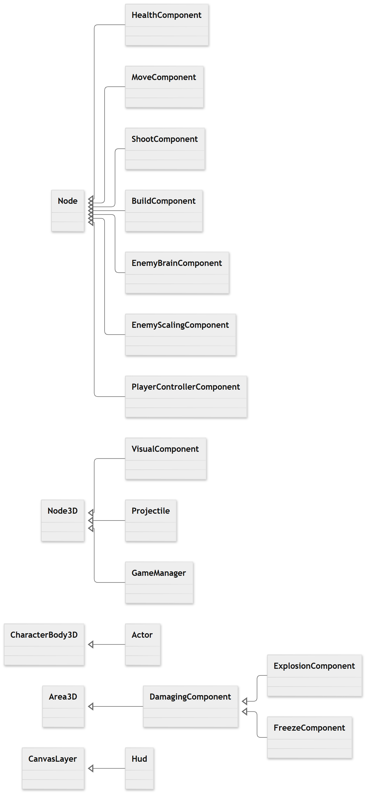
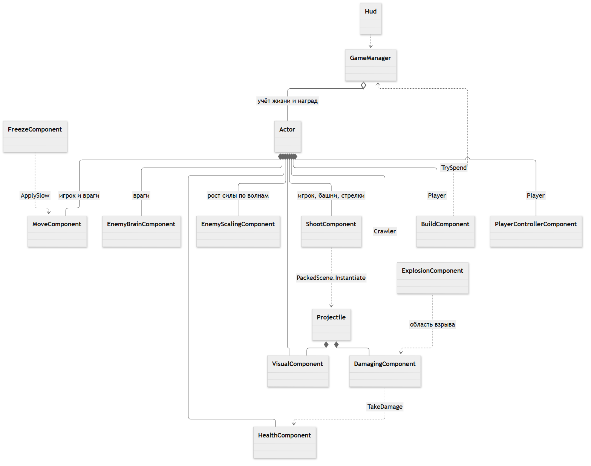

# Core Defense — лабораторная работа №3

Прототип 3D Tower Defense на **Godot 4.7.2 .NET и C#**. Игрок лично защищает ядро, стреляет и строит три типа неподвижных башен. Противники атакуют в ближнем бою и стреляют. Реализованы все игровые пункты лабораторной, включая дополнительную экономику металла.

## Запуск

1. Установить Godot **4.7.2 .NET** и .NET SDK 8 или новее. Обычная сборка Godot без .NET не поддерживает C#.
2. Импортировать `project.godot` в Godot.
3. Нажать **Build / Сборка**, затем **F6** для открытой `Scenes/Main.tscn` или **F5** для запуска проекта.

Можно предварительно собрать код командой `dotnet build`. Проект использует `Godot.NET.Sdk/4.7.2`, целевая платформа — `net8.0`; он проверен с SDK 10.0.402. При первой сборке нужен доступ к NuGet либо уже установленные пакеты Godot. Рендерер Compatibility поддерживает OpenGL 3.3.

## Управление и игровой цикл

| Действие | Клавиши |
| --- | --- |
| Перемещение по XZ | WASD |
| Поворот и прицеливание | Мышь, луч камеры пересекает плоскость игрока |
| Стрельба | ЛКМ или пробел |
| Выбрать башню и показать её призрак | 1 — обычная, 2 — взрывная, 3 — крио |
| Включить предпросмотр / подтвердить строительство | E |
| Отменить строительство | Esc |
| Пауза / продолжить | P |
| Начать заново, в том числе после завершения | R |

На старте доступны 240 единиц металла, три защитные башни, ядро и игрок. Два разведчика уже находятся на поле. После их уничтожения начинается отсчёт подготовки к первой волне. Всего шесть волн: **10, 15, 20, 25, 30 и 35 противников**. Враги появляются каждые 0,65 секунды. Следующая волна начинается после уничтожения предыдущей и перерыва. Победа — уничтожить все волны; уничтожение ядра или гибель игрока завершают игру поражением. Игра останавливается, HUD показывает результат и возможность перезапуска.

С каждым номером волны враги становятся сильнее. При `n = номер волны − 1` здоровье умножается на `1 + 0,25n`, урон — на `1 + 0,15n`, скорость движения — на `1 + 0,04n`, скорострельность — на `1 + 0,08n`. Дальность стрелка начинается с **14** и увеличивается на **1,5** за волну: 14 → 15,5 → 17 → 18,5 → 20 → 21,5. Дистанция остановки растёт одновременно и остаётся на 1,5 меньше дальности оружия. Время жизни снаряда учитывает дальность, чтобы он долетал до цели. Здоровье и контактный урон ползунов также растут. Два стартовых разведчика имеют характеристики первой волны.

Призрак башни находится **перед персонажем**, следует за его прицелом и не содержит физических тел, коллайдеров или оружия. Зелёный призрак означает допустимую постройку, красный — недостаток металла, занятое место либо границу поля. Во время строительства персонаж продолжает двигаться, но не стреляет. Выбор 1–3 меняет тип предпросмотра. E подтверждает постройку, если условия выполнены; без режима строительства E сначала включает его. Ошибка сопровождается красным текстовым сообщением. Проверка позиции повторяется при подтверждении, металл списывается только за успешную постройку.

## Сцены

```text
Scenes/Main.tscn
└── GameManager (Node3D, GameManager.cs)
    ├── WorldEnvironment, Sun, Camera3D, Ground
    ├── Core (экземпляр Core.tscn)
    ├── Player (экземпляр Player.tscn)
    ├── StandardTower, ExplosiveTower, FreezeTower
    ├── Crawler, Shooter
    └── HUD (CanvasLayer, Hud.cs)

Scenes/Actors/
├── Player.tscn        Actor + Visual + Health + Move + Shoot + PlayerController + Build
├── Core.tscn          Actor + Visual + Health
├── StandardTower.tscn Actor + Visual + Health + Shoot(StandardBullet)
├── ExplosiveTower.tscn Actor + Visual + Health + Shoot(ExplosiveBullet)
├── FreezeTower.tscn   Actor + Visual + Health + Shoot(FreezeBullet)
├── Crawler.tscn       Actor + EnemyScaling + Visual + Health + Move + EnemyBrain + Damaging(контакт)
└── Shooter.tscn       Actor + EnemyScaling + Visual + Health + Move + EnemyBrain + Shoot(EnemyBullet)

Scenes/Projectiles/
├── StandardBullet.tscn  Projectile + Visual + DamagingComponent + CollisionShape3D
├── ExplosiveBullet.tscn Projectile + Visual + ExplosionComponent + CollisionShape3D
├── FreezeBullet.tscn    Projectile + Visual + FreezeComponent + CollisionShape3D
└── EnemyBullet.tscn     Projectile + Visual + DamagingComponent + CollisionShape3D
```

В дереве сокращены только суффиксы `Component`. Каждый компонент действительно записан в `.tscn` как отдельный дочерний узел. Все компоненты — `[GlobalClass] partial class`; их параметры редактируются в Inspector. `CollisionShape3D` у снаряда находится внутри компонента урона. Меши примитивов создаёт `VisualComponent`, а HUD строит стандартные Godot Controls. Дополнительные ассеты не нужны.

## Назначение классов

| Класс | Ответственность |
| --- | --- |
| `GameManager : Node3D` | Singleton-подобный `Instance`, список существующих Actor, металл, волны, спавн, победа и поражение. При удалении погибшего врага или башни начисляет награду ровно один раз. При выгрузке сцены наград нет. |
| `Actor : CharacterBody3D` | Общий тонкий координатор всех персонажей и структур. Подписывается на смерть, регистрирует объект в менеджере, удаляет владельца и сообщает об уничтожении ядра/игрока. Хранит экспортируемые стоимость и награду. |
| `HealthComponent : Node` | Максимальное и текущее здоровье, `TakeDamage`, сигналы `Changed` и `Died`. Здоровье не уходит ниже нуля; повторная смерть исключена. |
| `MoveComponent : Node` | Движение владельца через `MoveAndSlide`, скорость, ограничение поля и временное замедление. Направление передаёт управляющий компонент. |
| `ShootComponent : Node` | Кулдаун, радиус, ближайшая живая цель из группы, поворот и создание экземпляра экспортируемой сцены снаряда. Используется игроком, башнями и стрелками. У игрока автоматический поиск отключён, направление задаёт мышь. |
| `DamagingComponent : Area3D` | Вся общая логика попадания: фильтрация групп, величина урона, `ApplyDamage(target)`, `TryHit`, индивидуальные интервалы контакта, одноразовое самоуничтожение. При контакте работает многократно, на пуле — один раз. |
| `ExplosionComponent : DamagingComponent` | При попадании создаёт отдельную большую сферическую Area3D с обычным DamagingComponent. За короткую жизнь область повреждает каждую подходящую цель один раз. Прозрачная расширяющаяся сфера показывает радиус взрыва. |
| `FreezeComponent : DamagingComponent` | Наносит прямой урон и передаёт временное замедление в MoveComponent цели; повторные попадания обновляют длительность без перемножения скорости. После окончания восстанавливается исходная скорость. Мятная вспышка показывает попадание. |
| `EnemyBrainComponent : Node` | Выбирает ближайшего живого союзника: ядро, игрока или башню. Ползун подходит для контакта, стрелок останавливается на дистанции огня. Разведение соседей уменьшает скопление врагов. |
| `EnemyScalingComponent : Node` | До инициализации здоровья применяет уровень волны к базовым параметрам экземпляра: здоровье, контактный/пулевой урон, скорость, скорострельность, дальность и дистанция остановки. PackedScene остаётся неизменной. Коэффициенты роста экспортированы. |
| `PlayerControllerComponent : Node` | Читает WASD, вычисляет направление мыши на плоскости XZ и вызывает оружие. Сам не реализует движение или урон. |
| `BuildComponent : Node` | Выбор PackedScene, призрак, проверка свободного места и границы, стоимость из сцены башни, запрос списания и установка. |
| `VisualComponent : Node3D` | Разные силуэты из стандартных примитивов, цвет команды, полоска здоровья, прозрачность призрака и краткие эффекты. |
| `Projectile : Node3D` | Только прямолинейное движение и время жизни. Не ищет HealthComponent и не наносит урон. |
| `Hud : CanvasLayer` | Металл, здоровье ядра и игрока, волна, враги, подсказки, ошибки, пауза и перезапуск. Работает и при остановленном дереве. |
| `IntegrationTests : Node` | Интеграционные проверки реальных сцен и физических контактов. Не участвует в основной игре. |
| `Preview : Node` | Вспомогательная сцена захвата изображения после отрисовки; не участвует в основной игре. |

## UML: наследование и композиция

Диаграммы сохранены как PNG и отображаются без запуска Mermaid в браузере. Нажмите на изображение, чтобы открыть его в полном размере.

**Наследование.** Полый треугольник указывает на базовый класс.



**Композиция и взаимодействие.** Закрашенный ромб обозначает дочерний узел, пустой — учёт объектов менеджером; пунктирная стрелка — вызов или создание объекта.



Редактируемые исходники: [наследование](docs/inheritance.mmd), [композиция](docs/composition.mmd).

Для обновления изображений после изменения исходников:

```powershell
npx.cmd --yes --package @mermaid-js/mermaid-cli mmdc -i docs/inheritance.mmd -o docs/inheritance.png -b white -s 2
npx.cmd --yes --package @mermaid-js/mermaid-cli mmdc -i docs/composition.mmd -o docs/composition.png -b white -s 2
```

Башни и враги не образуют иерархию наследования. Один Actor получает разные дочерние узлы. Например, замена `ProjectileScene` у ShootComponent меняет способ нанесения урона без изменения самого оружия. Один и тот же DamagingComponent применён к обычной пуле, красной пуле, взрывной области и контактной зоне Crawler. Наследование используется только для двух специализированных компонентов урона, как требует лабораторная.

## Баланс и настройки

Все игровые числовые параметры экспортированы: здоровье, стоимость, награда, скорость, дальность, интервалы, жизнь снаряда, урон, радиус взрыва, сила/длительность заморозки, дистанция и зазор строительства, граница поля, параметры волн. Геометрия коллайдеров, позиция камеры и свет доступны в ресурсах сцен; общий масштаб моделей и размеры полос здоровья — у VisualComponent.

| Объект | Здоровье | Цена | Металл за уничтожение | Оружие |
| --- | ---: | ---: | ---: | --- |
| Игрок | 120 | — | — | 20 урона / 0,22 с |
| Ядро | 500 | — | — | Нет |
| Обычная башня | 140 | 50 | 20 | 20 урона / 0,55 с |
| Взрывная башня | 170 | 80 | 30 | 30 урона по области радиусом 3,2 / 1,3 с |
| Криобашня | 120 | 70 | 25 | 10 урона / 0,75 с; скорость цели ×0,3 на 2,8 с |
| Crawler | 70 | — | 15 | 10 урона при контакте / 0,8 с на цель |
| Shooter | 90 | — | 20 | 12 урона / 1,4 с |

Стоимость задаётся в корневом Actor каждой сцены башни, а не в UI. Металл начисляется менеджером по `TreeExiting` только при нулевом здоровье объекта. За обычное переключение сцены награда не выдаётся. Призрак не регистрируется как Actor и не имеет стоимости или награды в менеджере.

## Группы, слои и цвета

| Группа | Назначение |
| --- | --- |
| `allies` | Игрок, ядро, дружественные башни; цели врагов |
| `enemies` | Crawler и Shooter; цели игрока и башен |
| `player`, `core`, `towers` | Роль объекта, проверка завершения игры и наград |
| `actors` | Проверка занятости места строительства |
| `projectiles` | Экземпляры снарядов |

Физический слой 1 — союзники, слой 2 — враги. Тела имеют маску 3 и сталкиваются друг с другом; их движение ограничено плоскостью. Союзный урон имеет слой 0 и маску 2, вражеский — маску 1. Фильтрация групп дополнительно исключает урон своим. На полу физический коллайдер не нужен: гравитация не используется, положение по Y постоянно.

Игрок и башни зелёные, взрывная башня отличается двумя стволами и салатовым цветом, криобашня — треугольным корпусом и мятным цветом. Противники и их снаряды красные, ядро — синее с крупным кристаллом. Ядро не содержит MoveComponent и ShootComponent; башни не содержат MoveComponent; Crawler не содержит ShootComponent.

## Проверки

```powershell
dotnet build
# Заменить путь до Godot на установленный у вас:
& 'C:\path\to\Godot_console.exe' --headless --path . res://Tests/IntegrationTests.tscn
# Или выполнить скрипт обеих проверок:
powershell -NoProfile -ExecutionPolicy Bypass -File tools/validate.ps1 -Godot 'C:\path\to\Godot_console.exe'
```

В тесте проверяются три стартовые башни, создание призрака, успешная постройка со списанием цены, отказ при занятом месте, фильтрация своих, обычный урон, кулдаун контакта, заморозка и восстановление скорости, взрыв по двум целям без повторного урона, настоящий контакт Crawler с игроком, награда за врага и башню, создание и попадание движущейся пули игрока, нехватка металла, поражение от уничтожения ядра/игрока и победа после последней волны. Дополнительно проверены полное усиленное здоровье, рост скорострельности/скорости/контактного урона, синхронный рост дальности и дистанции остановки, реальное попадание усиленного снаряда с расстояния 20 и увеличение количества врагов с 10 до 15 между первой и второй волнами. Ожидаемый итог: **`PASS: 27 integration checks`**, код завершения 0.

Также проверены импорт редактором Godot 4.7.2, рендеринг основной сцены через OpenGL и обычная главная сцена в headless с фиксированным шагом на 9000 кадров. Последняя сборка и 27 интеграционных проверок проходят без предупреждений и ошибок. Автоматические проверки не заменяют ручную оценку удобства управления.

## Соответствие заданию

| Критерий | Реализация |
| --- | --- |
| Игрок, ядро, башни, враги, Move/Shoot/Health | Main.tscn и компоненты на C#, здоровье и завершение игры |
| Постановка через игрока | BuildComponent: призрак перед игроком, выбор типа и подтверждение |
| Общий DamagingComponent : Area3D | Стандартные пули обеих сторон и контакт Crawler |
| Два дополнительных компонента и три башни | ExplosionComponent, FreezeComponent; три отдельные сцены башен |
| Читаемый код, Export, документация с UML | Scripts/Components, отдельные сцены, этот README |
| Дополнительная система металла | GameManager, цены в сценах, награды, красные сообщения об ошибках |

## Сдача на GitHub

Репозиторий для сдачи: https://github.com/velikiy-trahatel-planet/-3.-Tower-Defense.

Для публикации из этой папки, при наличии установленного Git и доступа к аккаунту GitHub:

```powershell
powershell -NoProfile -ExecutionPolicy Bypass -File tools/publish.ps1
```

Скрипт клонирует ветку main в новый каталог `.pipeline/publish-…`, сохраняет существующую историю и посторонние файлы, копирует исходники лабораторной, создаёт коммит и отправляет его без принудительной перезаписи истории. Если GitHub запросит вход, используйте обычный способ авторизации Git на своём компьютере. Готовый архив исходников находится в `dist/TowerDefense-source.zip`; его можно распаковать и открыть как обычный Godot-проект.

`.gitignore` исключает кэш Godot, результаты сборки, архив и временные данные. В репозиторий входят исходники, сцены, `TowerDefense.csproj`, `project.godot`, тесты, README и документ задания.

`.pipeline/create_scenes.py` — вспомогательный генератор начальных сцен. Для запуска игры он не нужен. Его повторный запуск перезаписывает сцены и project.godot; повседневные изменения следует выполнять в Godot и C#.
